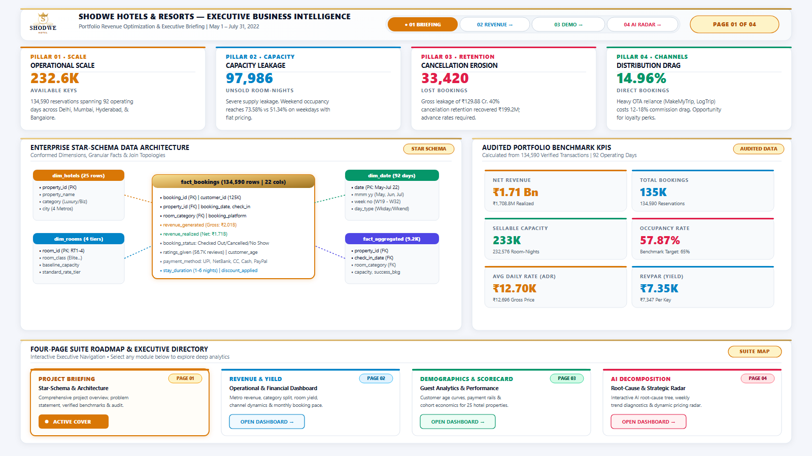

# Shodwe Hotels & Resorts — Hospitality Executive BI Suite

Multi-page **Power BI** and **Tableau** Business Intelligence suite analyzing **134,590 hospitality reservation records** across **25 luxury and business properties** over 92 operating days (May–July 2022).

---

## Overview

Revenue leakage from unoptimized weekday pricing, high cancellation ratios (`24.83%`), and heavy third-party OTA channel reliance impacts net RevPAR across multi-city hotel portfolios. This repository delivers a unified Star Schema analytics suite linking reservation fact data, room capacity utilization, guest demographics, and an AI Decomposition Tree into executive pricing recommendations.

---

## Audited Portfolio Benchmarks

- **Realized Net Revenue:** `₹1.71 Bn` (`₹1,708.8M` Net vs `₹2.01 Bn` Gross)
- **Total Reservations:** `134,590` (`22` columns across bookings, pricing, status, channel, and guest profile)
- **Sellable Capacity & Occupancy:** `232,576` room-nights · `57.87%` overall occupancy (`73.58%` weekend vs `51.34%` weekday)
- **Average Daily Rate (ADR) & RevPAR:** `₹12.70K` ADR · `₹7.35K` RevPAR
- **Cancellation Erosion:** `33,420` lost bookings (`24.83%`)
- **Direct Booking Share:** `14.96%`

---

## Four-Page Executive Suite

1. **Page 01 — Project Briefing & Star-Schema Architecture:** Problem pillars (Scale, Capacity Leakage, Cancellation Erosion, Distribution Drag), Star-Schema entity map, and verified portfolio benchmarks.
2. **Page 02 — Revenue & Yield Diagnostics:** Metro-city revenue split (Delhi, Mumbai, Hyderabad, Bangalore), property category performance, room-tier yield, and booking channel mix.
3. **Page 03 — Guest Demographics & 25-Property Scorecard:** Customer age distribution, payment method breakdown (`UPI`, NetBank, Card, Cash, PayPal), and property-level occupancy KPIs.
4. **Page 04 — AI Decomposition & Weekly Action Radar:** Hierarchical Power BI Decomposition Tree (`Revenue -> City -> Category -> Property`), weekly occupancy vs. revenue trends (`W19–W32`), and dynamic weekend pricing insights.



*(Full 4-page exported executive presentation PDF available at [`bi/Shodwe Hotels Hospitality Analytics.pdf`](bi/Shodwe%20Hotels%20Hospitality%20Analytics.pdf).)*

---

## Data Model (`Star Schema`)

| Table | Type | Rows | Description |
| :--- | :--- | :---: | :--- |
| `fact_bookings.csv` | Fact | `134,590` | Transaction-grain bookings, gross/net revenue, status, guest & channel attributes |
| `fact_aggregated_bookings.csv` | Fact | `9,200` | Daily capacity & successful booking aggregations by property & room class |
| `dim_hotels.csv` | Dimension | `25` | Property metadata (`Luxury`, `Business`) across 4 metro cities |
| `dim_date.csv` | Dimension | `92` | Calendar attributes (`May–Jul 2022`, `W19–W32`, `Weekday/Weekend`) |
| `dim_rooms.csv` | Dimension | `4` | Room classes (`RT1–RT4`) |

---

## Technology Stack

- **Power BI Desktop:** DAX KPI measures (`ADR`, `RevPAR`, `Occupancy %`, `Realisation %`, `DBRN`, `DURN`, `DSRN`), AI Decomposition Tree
- **Tableau Desktop:** Companion interactive workbook ([`bi/Hospitality Analytics.twbx`](bi/Hospitality%20Analytics.twbx))
- **MySQL:** Database schema validation queries ([`sql/hospitality_db_validation.sql`](sql/hospitality_db_validation.sql))

---

## Project Structure

```text
Shodwe-Hotels-Hospitality-BI/
├── assets/
│   └── shodwe_overview_dashboard.png               # Executive briefing & star schema overview
├── bi/
│   ├── Shodwe Hotels Hospitality Analytics.pbix    # Primary 4-page Power BI solution
│   ├── Shodwe Hotels Hospitality Analytics.pdf     # Full executive presentation PDF
│   └── Hospitality Analytics.twbx                  # Companion Tableau packaged workbook
├── data/
│   ├── dim_date.csv
│   ├── dim_hotels.csv
│   ├── dim_rooms.csv
│   ├── fact_aggregated_bookings.csv
│   └── fact_bookings.csv
├── sql/
│   └── hospitality_db_validation.sql               # MySQL row-count validation checks
├── LICENSE
└── README.md
```

---

## How to Open

- **Power BI:** Open [`bi/Shodwe Hotels Hospitality Analytics.pbix`](bi/Shodwe%20Hotels%20Hospitality%20Analytics.pbix) in Power BI Desktop.
- **Tableau:** Open [`bi/Hospitality Analytics.twbx`](bi/Hospitality%20Analytics.twbx) in Tableau Desktop.
- **PDF Report:** View [`bi/Shodwe Hotels Hospitality Analytics.pdf`](bi/Shodwe%20Hotels%20Hospitality%20Analytics.pdf) directly in GitHub or any PDF reader.

---

## License

MIT License — see [LICENSE](LICENSE).

## Author

**Yogesh Patil** — [@yogesh-patil2003](https://github.com/yogesh-patil2003) · [LinkedIn](https://www.linkedin.com/in/yogeshpatil2003/) · [Email](mailto:officialyogeshpatil0@gmail.com)
